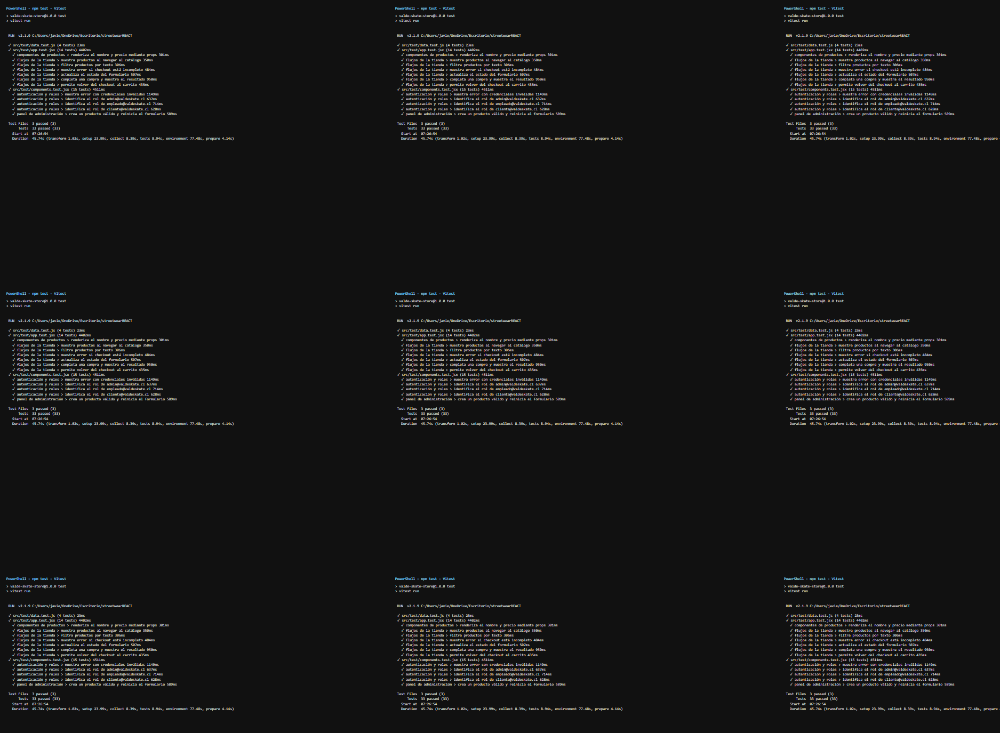
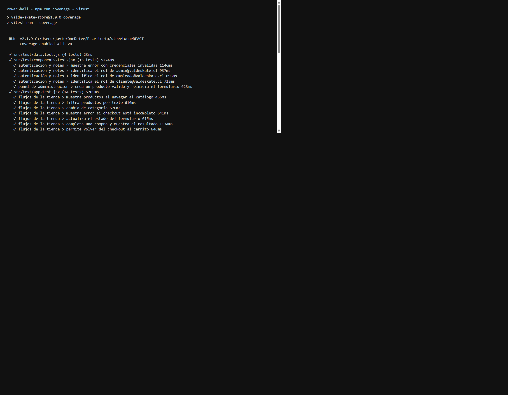
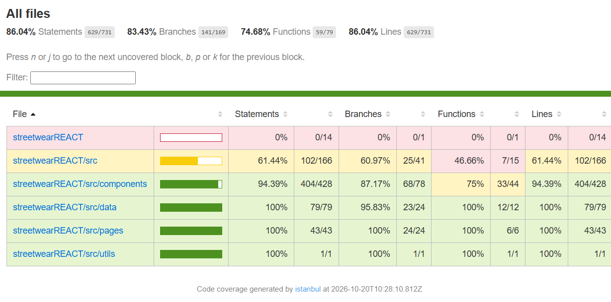

# Documento de cobertura de testing

## Herramientas

El proyecto utiliza Vitest como runner, `jsdom` para simular el navegador y React Testing Library para validar el DOM desde la perspectiva del usuario. `vi.fn()` se utiliza como mock para verificar callbacks recibidos por props.

## Alcance

La suite contiene 43 pruebas distribuidas en cuatro archivos:

| Área | Casos cubiertos |
| --- | --- |
| Componentes | Productos, carrito, checkout, resultado, encabezado y carrusel |
| Autenticación | Credenciales inválidas y detección de perfiles administrador, empleado y cliente |
| Administración | Crear, actualizar stock y eliminar productos |
| Operación | Actualización de estados de pedidos desde el panel de empleado |
| Cliente | Historial filtrado por correo y estado vacío |
| Catálogo | Búsqueda, categorías, ofertas y navegación desde la portada |
| Persistencia | Lectura, escritura y eliminación de `localStorage`, productos y pedidos |
| Flujo de compra | Agregar productos, modificar cantidades, validar checkout y confirmar compra |

Archivos de prueba:

- `src/test/app.test.jsx`: flujos principales de la tienda.
- `src/test/components.test.jsx`: componentes, roles y vistas.
- `src/test/data.test.js`: persistencia y operaciones de productos/pedidos.
- `src/test/routing.test.jsx`: enlaces activos, detalle dinámico, protección de rutas, 404 y redirecciones.

Últimos resultados validados:

- **43/43 pruebas exitosas**.
- **90,63 % de statements**.
- **88,20 % de branches**.
- **77,52 % de funciones**.
- **90,63 % de líneas**.

## Análisis

Los componentes (`src/components`) tienen 93,06 % de cobertura de statements. La lógica de datos (`src/data`) alcanza 100 % de statements y 96 % de branches. Las páginas (`src/pages`) alcanzan 93,57 % de statements y las utilidades (`src/utils`) presentan 100 % en las cuatro métricas.

El archivo `src/App.jsx` alcanza 79,78 % de statements. Los archivos de arranque, configuración, pruebas y salida generada se excluyen del cálculo porque no representan lógica de negocio ejecutable durante las pruebas.

Las pruebas verifican renderizado, props, estado, eventos, autenticación, navegación con React Router, enlaces activos, detalle dinámico, rutas privadas, página 404, catálogo, administración, confirmación de eliminaciones, ofertas, carrito, compras, persistencia y recuperación ante datos inválidos en `localStorage`.

## Capturas

Guardar las imágenes en `docs/capturas/` y mantener estas referencias:

Ejecución de pruebas (`npm test`) con 43/43 aprobadas:

Salida de cobertura en consola (`npm run coverage`):

Reporte HTML (`coverage/index.html`):

Ejecutar `npm install`, `npm test` y `npm run coverage` para generar el reporte HTML en `coverage/`.